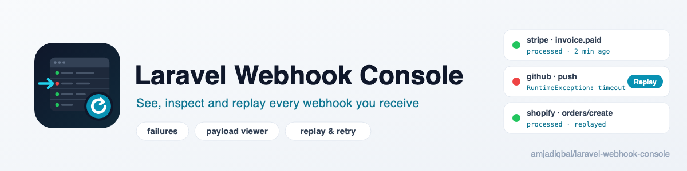

  <picture>
    <source media="(prefers-color-scheme: dark)" srcset="art/banner-dark.png">
    
  </picture>

# Laravel Webhook Console

A dashboard and replay tool for `spatie/laravel-webhook-client`. Work in progress.
