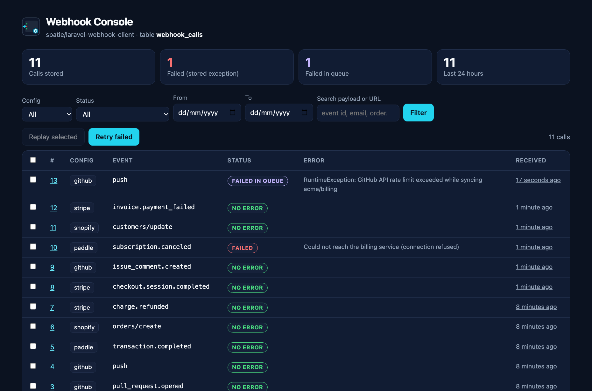

<p align="center">
  <picture>
    <source media="(prefers-color-scheme: dark)" srcset="art/banner-dark.png">
    
  </picture>
</p>

# Laravel Webhook Console: a dashboard and replay tool for spatie/laravel-webhook-client

[`spatie/laravel-webhook-client`](https://github.com/spatie/laravel-webhook-client) stores every webhook your
Laravel app accepts in the `webhook_calls` table, but it has no screen to look at them. This package adds one:
a gated dashboard that lists your Stripe, GitHub, Shopify or any other webhooks by config, status and date,
shows each payload and its headers **with secrets masked**, shows **why a webhook failed**, and lets you
**replay one call or bulk-retry every failure** with a click or from artisan.

It is read-only by default. Replay and prune each sit behind their own gate.

Docs and demo: https://amjad.com.pk/laravel/packages/laravel-webhook-console

[](https://packagist.org/packages/amjadiqbal/laravel-webhook-console)
[](https://packagist.org/packages/amjadiqbal/laravel-webhook-console)
[](LICENSE.md)

<p align="center">
  
</p>

```bash
composer require amjadiqbal/laravel-webhook-console
```

Then open `/webhook-console` in your local environment.

## Why failures are hard to see without it

webhook-client writes an `exception` on a call only when **dispatching** its process job fails, or when the
job throws on the `sync` queue. When your job throws on a real queue worker, which is the usual case in
production, the call keeps `exception = NULL` and the failure only exists in `failed_jobs`, with nothing that
points back to the webhook.

The console reads both. It links each `failed_jobs` row to its webhook call (from the serialized job's model
id, read with a regex and never unserialized), so every call has one of three statuses:

| Status | Meaning |
|---|---|
| **Failed** | webhook-client stored an exception on the call |
| **Failed in queue** | the process job failed on a queue worker and is in `failed_jobs` |
| **No error** | nothing failed that the console can see |

## Requirements

- PHP 8.3+, Laravel 12 or 13
- `spatie/laravel-webhook-client` 3.4+ (installed for you), already receiving webhooks
- Queue failures are read from the `database` or `database-uuids` failed job driver (Laravel's default).
  Other drivers still get everything else; the dashboard says why queue failures are missing.

## Access: three gates

| Gate | Allows | Default |
|---|---|---|
| `viewWebhookConsole` | the dashboard, payloads, headers, failures | local environment only |
| `replayWebhookCalls` | Replay, Replay selected, Retry failed | local environment only |
| `pruneWebhookCalls` | deleting old calls from the dashboard | local environment only |

Outside `local`, nobody gets in until you define the gates, for example in `AppServiceProvider::boot()`:

```php
use App\Models\User;
use Illuminate\Support\Facades\Gate;

Gate::define('viewWebhookConsole', fn (User $user) => $user->is_admin);
Gate::define('replayWebhookCalls', fn (User $user) => $user->is_admin);
Gate::define('pruneWebhookCalls', fn (User $user) => false); // view and replay only
```

A guest never passes a gate that type-hints `User`. Someone who can view but not replay sees the dashboard
in read-only mode, without the replay buttons; the replay and prune routes return 403 for them.

## What you can do

**List and filter.** Every stored call with its config name, event (Stripe's `type`, GitHub's `action`,
Shopify's `topic`...), status, error and age. Filter by config, status, date range, or search inside the
payload and URL (an event id, a customer email, an order number). Works on MySQL, MariaDB, PostgreSQL and
SQLite.

**Inspect one call.** The payload as pretty JSON with a copy button, the stored headers, uploaded file names
and sizes (never their content), the stored exception with its stack trace, and the `failed_jobs` exception
for queue failures.

**Masking.** Payload keys, header names and URL query parameters whose name contains `password`, `secret`,
`token`, `authorization`, `signature`, `api_key`, `cookie`, `card_number`, `cvc`, `iban` and similar are
shown as `••••••`, at any depth. The signature header of every webhook-client config is always masked. The
list is in the config file. Masked values stay masked in the copy button too.

**Replay.** Dispatches the call's configured `process_webhook_job` again, exactly as webhook-client does for a
new webhook: the job from the call's config, `clearException()`, `dispatch()`, and `saveException()` if
dispatching throws. Nothing is sent over the network and the signature is not checked again; the stored
call is simply processed again, so your job should be safe to run twice for the same event (most webhook
handlers already are, because providers retry too).

**Bulk retry.** Tick calls and click *Replay selected*, or click *Retry failed* to replay every failure that
matches the current filters (up to `bulk_limit`, 100 by default). Calls are replayed oldest first.

**Prune.** Delete calls older than N days, for all configs or one. webhook-client can also do this on a
schedule with `php artisan model:prune --model="Spatie\WebhookClient\Models\WebhookCall"`, using its
`delete_after_days` setting.

## Artisan

```bash
php artisan webhooks:failed                       # failed calls (stored exception or failed queue job)
php artisan webhooks:failed --since=24h --strict  # exit code 1 when anything failed: CI, cron, monitoring
php artisan webhooks:failed --name=stripe --json

php artisan webhooks:replay 41 42                 # replay these calls
php artisan webhooks:replay --failed --dry-run    # what would be replayed
php artisan webhooks:replay --failed --since=2h --force
```

`webhooks:replay` asks before replaying; non-interactive runs need `--force`. It exits 1 when any replay
could not be dispatched, so it is safe to use in scripts. To be told about failures, schedule the check:

```php
// routes/console.php
Schedule::command('webhooks:failed --since=1h --strict')->hourly()->emailOutputOnFailure('ops@example.com');
```

## Custom webhook models

Each webhook-client config can set its own `webhook_model`. The console reads every config:

- A call is replayed through its own config's model, so a job that type-hints your model gets that model.
- If configs use models with **different tables**, the dashboard shows a table switcher and
  `webhooks:replay --source=<table>` picks one; `webhooks:failed` covers all of them.
- Calls whose config name no longer exists are still listed, but can't be replayed (the dashboard says why).
  The same goes for the published default config, whose `process_webhook_job` is empty.

## Configuration

```bash
php artisan vendor:publish --tag=webhook-console-config
```

| Key | Default | |
|---|---|---|
| `dashboard.enabled` | `true` (`WEBHOOK_CONSOLE_DASHBOARD`) | `false` removes the routes |
| `dashboard.path` | `webhook-console` (`WEBHOOK_CONSOLE_PATH`) | |
| `dashboard.domain` | `null` (`WEBHOOK_CONSOLE_DOMAIN`) | |
| `dashboard.middleware` | `['web']` | the view gate is always added after these |
| `dashboard.per_page` | `50` | |
| `mask` | password, secret, token, ... | words matched inside key and header names |
| `failed_jobs.enabled` | `true` | read `failed_jobs` for queue failures |
| `failed_jobs.scan_limit` | `1000` | newest `failed_jobs` rows read per request |
| `bulk_limit` | `100` | the most calls one bulk retry replays |

The views can be published with `--tag=webhook-console-views`.

### How a replayed queue failure stops counting

Replaying touches the call (`updated_at`). A `failed_jobs` row older than the call's `updated_at` belongs to
an earlier attempt, so the call shows as *No error* again, with the old failure still visible on its page as
*Earlier queue failure (replayed since)*. If the replayed job fails again, a newer row appears and the call is
*Failed in queue* again. The `failed_jobs` rows themselves are never changed or deleted.

## Testing

```bash
composer test               # Pest, on SQLite
scripts/integration.sh      # the same suite on real MySQL 8.4 and PostgreSQL 17 (Docker)
scripts/ci-local.sh         # PHP 8.3/8.4/8.5 x Laravel 12/13, Pint, PHPStan, then the integration run
```

## Need this built into your app, or something custom?

I build and maintain Laravel apps that live on webhooks: payment providers, GitHub and Shopify apps, and the
queue workers behind them. If you would rather have someone set up reliable webhook handling with you, or
you need something this package does not do,
[get in touch](https://amjad.com.pk/contact?utm_source=github&utm_medium=readme&utm_campaign=laravel-webhook-console).

## Support

- 🐛 **Bug or feature request**: [open an issue](https://github.com/amjadiqbal/laravel-webhook-console/issues)
- 🔒 **Security issue**: please report privately via GitHub's security tab

## Need this customised, or something built?

I'm available for custom development, package integration, and technical consulting.

[](https://www.upwork.com/freelancers/amjadkhatri)

## More packages

Part of a family of open-source packages. See [all of them](https://github.com/amjadiqbal?tab=repositories).

| | |
|---|---|
| [laravel-mysql-advisor](https://github.com/amjadiqbal/laravel-mysql-advisor) | MySQL and MariaDB health checks with the SQL to fix each problem |
| [kiln](https://github.com/amjadiqbal/kiln) | Deploy-time OPcache control for Laravel |
| [laravel-logpulse](https://github.com/amjadiqbal/laravel-logpulse) | Log health monitoring and alerting |
| [laravel-driver-js](https://github.com/amjadiqbal/laravel-driver-js) | Product tours and onboarding for Laravel |

## Changelog

See [CHANGELOG.md](CHANGELOG.md).

## License

MIT. See [LICENSE.md](LICENSE.md). This package is independent and is not made or endorsed by Spatie;
`spatie/laravel-webhook-client` is their MIT-licensed package.
